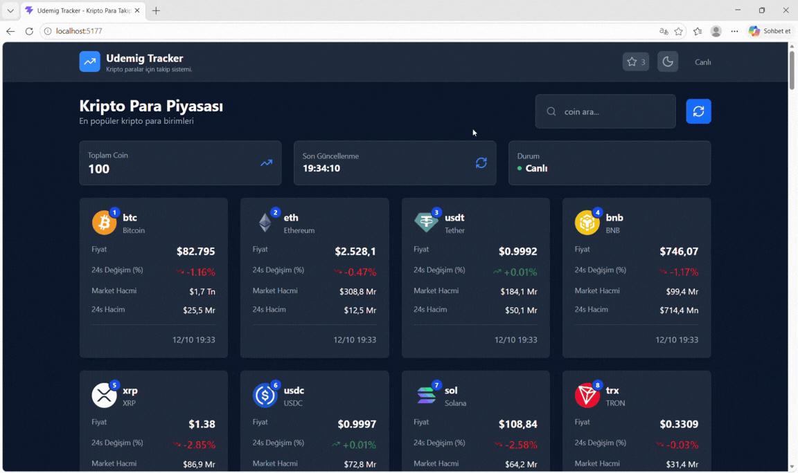

# 📈 Crypto Tracker

A modern and responsive cryptocurrency tracking application built with **React and modern frontend technologies**. It allows users to explore cryptocurrency market data, view detailed coin information, and switch between dark and light themes.

## 🎯 Project Overview

This project was developed to improve my frontend development skills by working with API integration, state management, reusable components, and custom React hooks.

## 🛠️ Technologies Used

- **React** – Building interactive user interfaces
- **Vite** – Development server and build tool
- **React Router DOM** – Client-side routing
- **Context API** – Global theme management
- **Custom Hooks** – Reusable stateful logic
- **Tailwind CSS** – Styling and responsive layouts
- **Axios** – HTTP requests and API communication
- **CoinGecko API** – Cryptocurrency market data

## Preview

